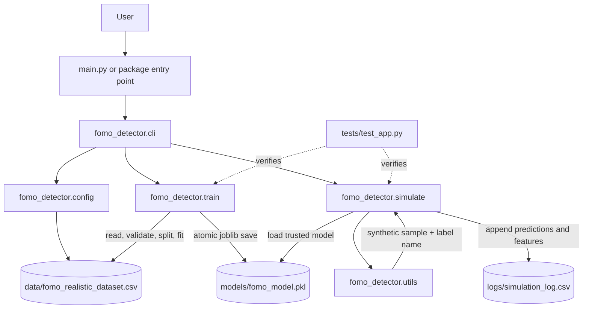
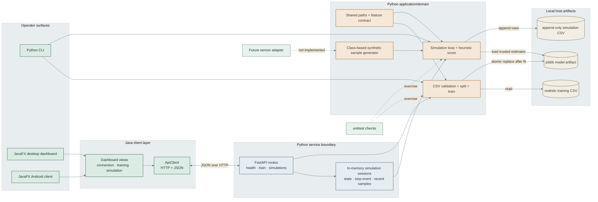
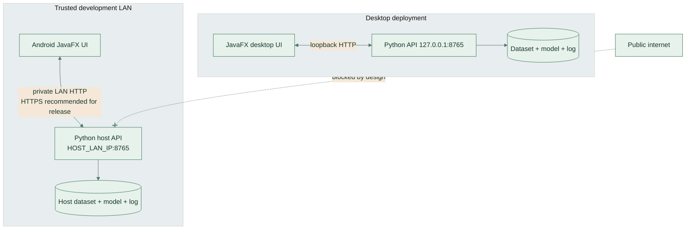
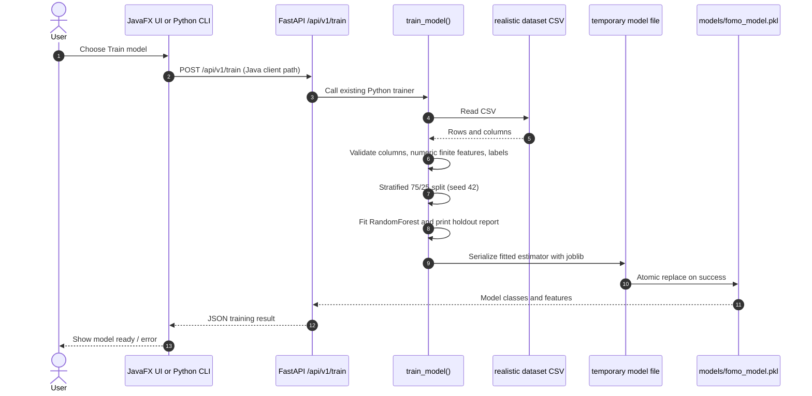
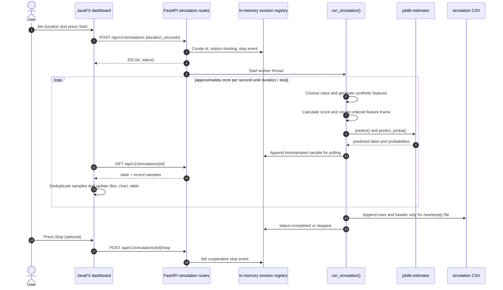
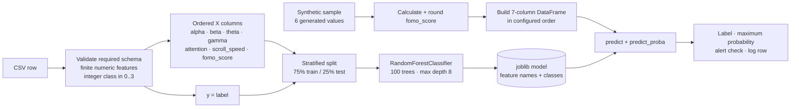
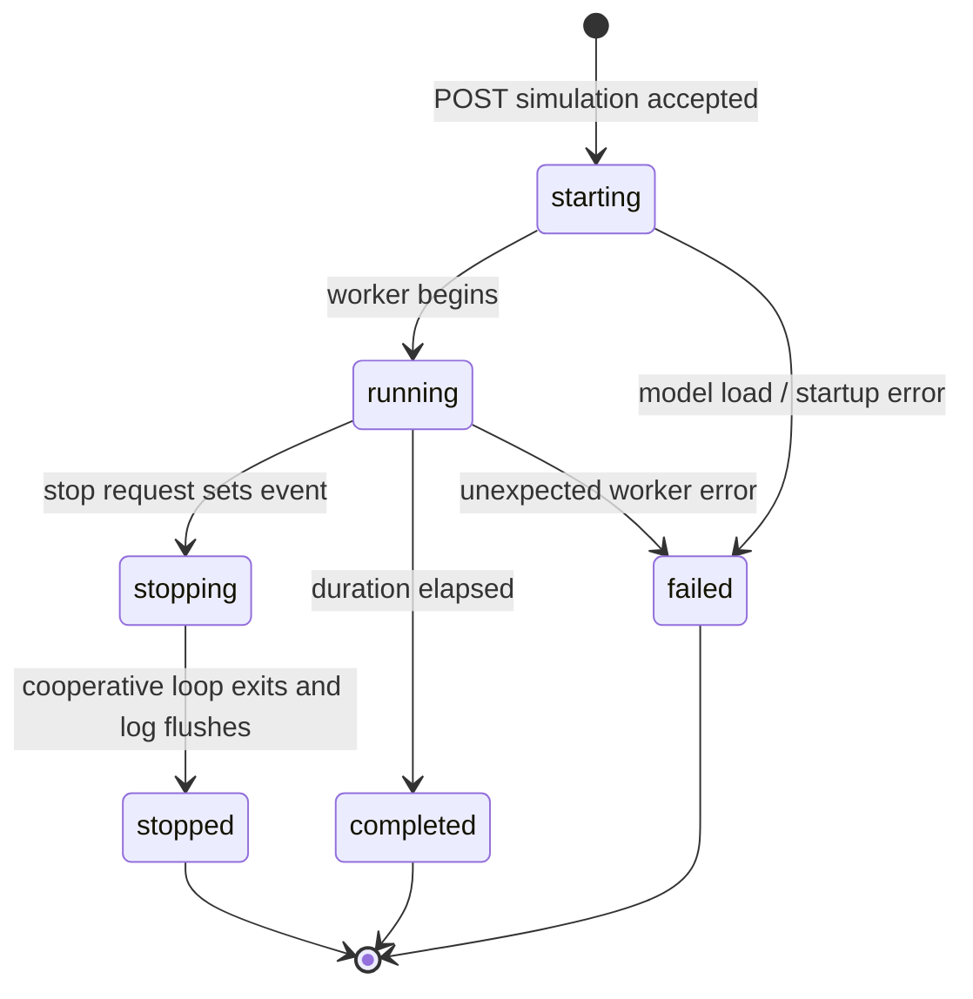

# FOMO Detector

FOMO Detector is a Python command-line project for experimenting with a
Random Forest classifier over synthetic EEG-style features. It has two related
flows: train a classifier from a CSV dataset, and run a timed simulation that
generates synthetic samples, predicts labels, and appends results to a CSV log.

> **Important scope note:** This project does not connect to an EEG headset,
> measure human attention, or diagnose FOMO, emotion, or any health condition.
> The feature values and simulation labels are generated or supplied as dataset
> values for software experimentation. The model and its confidence values are
> not clinically validated.

## Project Status

The current executable application is Python. This workspace has no Java
source files, JavaFX application, Maven/Gradle build, or Java runtime component.
The historical Java-upgrade notes are not part of the application runtime.

Implemented:

- A CLI with an interactive menu and `train` / `simulate` subcommands.
- Dataset schema, numeric-value, class, and minimum-class-size validation.
- A stratified train/test split and Random Forest training report.
- Atomic replacement when saving a newly trained model.
- Synthetic sample generation, prediction, confidence display, and a simple
  sustained-score alert.
- CSV simulation logging that appends rows instead of replacing prior runs.
- Unit tests for the dataset, training, scoring, model save, and log append paths.

Not implemented: real EEG acquisition, a web or desktop GUI, persistent user
accounts, a REST API, streaming ingestion, alert delivery, model monitoring,
experiment tracking, and a validated clinical or psychological instrument.

## Architecture



### Components

| Component | Responsibility | Why it exists |
| --- | --- | --- |
| `main.py` | Small compatibility entry point that calls the CLI. | Keeps the familiar `python main.py` workflow without putting all application logic in one file. |
| `fomo_detector/cli.py` | Defines command-line arguments, the interactive menu, and error reporting. | Separates user interaction from model and simulation logic. |
| `fomo_detector/config.py` | Defines paths, feature names, label column, and timestamp column. | Gives training and simulation one shared schema and repository-relative artifact locations. |
| `fomo_detector/train.py` | Reads and validates data, splits it, trains/evaluates the classifier, and saves it. | Keeps the model-training workflow isolated and reusable from both CLI modes. |
| `fomo_detector/simulate.py` | Loads a model, generates predictions, evaluates the score rule, and appends a CSV log. | Owns the timed simulation workflow and its output schema. |
| `fomo_detector/utils.py` | Maps numeric labels to names and generates synthetic class samples. | Shares simulation sample generation and label presentation logic. |
| `fomo_detector/__main__.py` | Runs the CLI for `python -m fomo_detector`. | Provides the standard Python package execution form. |
| `tests/test_app.py` | Exercises important training and simulation behavior. | Catches regressions without modifying the retained model or main log. |
| `pyproject.toml` | Declares package metadata, supported Python version, dependencies, and console script. | Lets pip install the application and create the `fomo-detector` command. |
| `requirements.txt` | Installs this project in editable mode (`-e .`). | Keeps dependency declarations centralized in `pyproject.toml`. |

## End-to-End Data Flow

### Training

1. The user runs `fomo-detector train` or selects **Train model** in the menu.
2. The CLI calls `train_model()` with the configured dataset and model paths;
   `--data` and `--model` can override these paths.
3. `load_training_data()` reads the CSV with pandas.
4. It checks that all seven model features, the `label` target, and `timestamp`
   exist. It checks non-empty data, numeric finite features, integer labels,
   all four expected labels, and at least two rows in every class.
5. The seven feature columns become `X`; `label` becomes `y`. `timestamp` is
   required by the input schema but is not passed to the classifier.
6. Scikit-learn splits the rows into 75% training and 25% test data using a
   stratified split and fixed random seed `42`.
7. A `RandomForestClassifier` is fit on the training partition. A classification
   report is printed for the held-out partition.
8. The fitted estimator is serialized with joblib to a temporary file beside
   the target model, then atomically moved into place. A failed write should not
   leave a partially written replacement model.

### Simulation

1. The user runs `fomo-detector simulate --duration 30` or chooses **Run
   simulation** in the menu.
2. The application validates that duration is finite and greater than zero,
   then loads the model artifact with joblib.
3. The loaded model's feature names are checked against the current seven-column
   feature schema.
4. Until the requested duration elapses, the simulator chooses one of four
   labels at random, generates one synthetic sample for that label, computes a
   FOMO-style score, and asks the model for a prediction and class
   probabilities.
5. It prints the generated label, predicted label, maximum class probability,
   and score. A simple alert is printed when the score exceeds `0.75` on five
   consecutive samples. A sample is generated about once per second.
6. Samples are appended to the configured log CSV. A header is written only
   when the file is new or empty.

The simulation's randomly selected label is a synthetic reference label, not an
independent measurement of a person's mental state. Therefore, `Actual` versus
`Predicted` output is a simulation comparison, not a real-world observation.

## Data Dictionary

### Model Input Dataset

The default training file is `data/fomo_realistic_dataset.csv`. Its current
observed shape is 5,000 rows and 9 columns. The initial dataset has 5,000 rows
and 8 columns. The current class counts below describe the files present when
this README was written; they will change if the local datasets are replaced.

| Column | Role | Description in this application |
| --- | --- | --- |
| `timestamp` | Required metadata | Timestamp-like value carried in the dataset. It is validated for presence but is not used as a feature. |
| `alpha` | Model feature | Synthetic scalar named for an EEG band. No physical unit or live EEG meaning is established by this application. |
| `beta` | Model feature | Synthetic scalar named for an EEG band. |
| `theta` | Model feature | Synthetic scalar named for an EEG band. |
| `gamma` | Model feature | Synthetic scalar named for an EEG band. |
| `attention` | Model feature | Synthetic scalar used by this demonstration; it is not measured attention. |
| `scroll_speed` | Model feature | Synthetic scroll-speed-like scalar. |
| `fomo_score` | Model feature | Score supplied by the realistic training dataset and derived from the other simulation features by the formula below. |
| `label` | Target | Integer class: `0` Normal, `1` FOMO, `2` Relaxed, `3` Focused. |

The classifier feature order is defined in `fomo_detector/config.py`:

```text
alpha, beta, theta, gamma, attention, scroll_speed, fomo_score
```

Current observed class counts:

| Dataset | Rows | Normal (`0`) | FOMO (`1`) | Relaxed (`2`) | Focused (`3`) |
| --- | ---: | ---: | ---: | ---: | ---: |
| `fomo_initial_dataset.csv` | 5,000 | 1,218 | 1,251 | 1,255 | 1,276 |
| `fomo_realistic_dataset.csv` | 5,000 | 1,492 | 1,564 | 978 | 966 |

**Important:** `fomo_initial_dataset.csv` currently does not have a `fomo_score`
column. It is retained as a source/alternate dataset but does not pass the
current trainer's required-column validation as-is. To train from it, first
derive and add `fomo_score`, or update the application schema and training
pipeline deliberately.

### Labels and Synthetic Sample Generation

| Numeric label | Display name | Synthetic ranges before shared noise |
| ---: | --- | --- |
| `0` | Normal | alpha 8–13; beta 10–18; theta 5–8; gamma 3–6; attention 40–70; scroll 1–3 |
| `1` | FOMO | alpha 6–12; beta 18–30; theta 4–9; gamma 4–9; attention 60–95; scroll 2–6 |
| `2` | Relaxed | alpha 10–20; beta 5–12; theta 6–10; gamma 2–5; attention 20–50; scroll 0–1.5 |
| `3` | Focused | alpha 8–14; beta 14–22; theta 5–9; gamma 4–8; attention 60–85; scroll 0–2 |

The ranges are generated independently with Python's `random.uniform`, with one
shared noise value from `-1` to `1` added to each generated sample. Attention
uses twice that noise. Consequently, final values can extend slightly beyond
the nominal ranges. The values are illustrative synthetic numbers, not EEG
measurements with calibrated units.

### Score Formula

The simulator computes:

$$
\text{fomo\_score} = 0.4\left(\frac{\text{beta}}{\text{alpha}+1}\right)
+ 0.3\left(\frac{\text{attention}}{100}\right)
+ 0.3\left(\frac{\text{scroll\_speed}}{6}\right)
$$

The score is rounded to three decimal places for prediction and logging. The
alert rule uses a fixed threshold of `0.75` and requires five consecutive
generated samples above that threshold. This is a hand-written demonstration
rule, not a learned or validated threshold.

### Simulation Log

The default output file is `logs/simulation_log.csv`. Each appended row has:

| Column | Meaning |
| --- | --- |
| `alpha`, `beta`, `theta`, `gamma` | Generated synthetic feature values. |
| `attention`, `scroll_speed` | Generated synthetic feature values. |
| `fomo_score` | Formula output used as the seventh model feature and by the alert rule. |
| `real_label` | Randomly selected synthetic class for generating the sample. |
| `predicted` | Class predicted by the saved classifier. |
| `confidence` | Maximum value returned by `predict_proba` for this row; it is not calibrated certainty. |

### Other Data Files

- `data/fomo_initial_dataset.csv`: Alternate 5,000-row dataset; it currently
  lacks the `fomo_score` feature required by the trainer.
- `emotions.csv`: A separate 2,132-row, 2,549-column emotion dataset with
  `NEGATIVE`, `NEUTRAL`, and `POSITIVE` labels. It is not read by the current
  application and is not part of the FOMO classifier's training or simulation
  flow.
- `models/fomo_model.pkl`: Existing serialized scikit-learn estimator. The
  application loads this file for simulation and writes it when training.

## Machine Learning Design

### Current Estimator

The trainer uses scikit-learn's `RandomForestClassifier` with:

| Setting | Value | Purpose |
| --- | ---: | --- |
| `n_estimators` | 100 | Number of decision trees in the ensemble. |
| `max_depth` | 8 | Limits tree depth to constrain model complexity. |
| `min_samples_split` | 5 | Requires a minimum number of rows to split an internal node. |
| `min_samples_leaf` | 3 | Requires a minimum number of rows in a terminal leaf. |
| `random_state` | 42 | Makes the estimator's random behavior repeatable for the same data and library environment. |
| `n_jobs` | -1 | Uses available CPU cores for supported parallel work. |

The choice is a practical tabular baseline: random forests can model
non-linear feature interactions, handle mixed feature scales without mandatory
standardization, and average across trees. The project does not claim that this
is the best model for the problem. It currently does not perform hyperparameter
search, cross-validation, calibration, feature selection, or a benchmark among
algorithms.

### Alternatives to Evaluate

These are candidate approaches, not implementations included in the project.
They should be compared using the same fixed data splits and metrics before
replacing the current estimator.

| Candidate | Potential reason to try it | Tradeoff to evaluate |
| --- | --- | --- |
| Logistic regression | Simple, fast, regularized baseline; coefficients can be inspected. | Linear decision boundary unless features/interactions are engineered; usually needs feature scaling. |
| Single decision tree | Easier to visualize and explain than a forest. | More sensitive to small data changes and likely to overfit without pruning. |
| Extra Trees | Another tree ensemble that may reduce variance and train quickly. | Still requires validation; feature importance can be biased and is not causal explanation. |
| Gradient boosting / HistGradientBoosting | Often strong on structured tabular data and can capture complex interactions. | More tuning-sensitive; calibration and overfitting still need evaluation. |
| Support vector machine | Can work well for smaller datasets and non-linear boundaries with kernels. | Requires feature scaling; probability output may need extra calibration; less convenient at larger data sizes. |
| k-nearest neighbors | Simple non-parametric comparison baseline. | Sensitive to scaling and irrelevant features; prediction cost grows with training-set size. |
| Multilayer perceptron | Flexible model for non-linear relationships. | Needs scaling and more careful tuning; this small tabular task does not justify neural complexity without evidence. |

For a meaningful model comparison, record per-class precision, recall, F1,
confusion matrices, macro-F1, calibration, and repeated or cross-validated
results. The current printed classification report is only one stratified
holdout evaluation, not a generalization guarantee.

## Technology Stack

| Technology | Where it is used | Why it is used here |
| --- | --- | --- |
| Python 3.10+ | Application and tests | Application language and package runtime. |
| pandas | CSV loading, selecting feature columns, data frames, and CSV log output | Convenient tabular I/O and column-oriented data handling. |
| NumPy | Finite-value validation for numeric feature matrices | Provides numeric array checks used before model fitting. |
| scikit-learn | Train/test split, Random Forest, predictions, probabilities, and classification report | Supplies established tabular ML algorithms and evaluation helpers. |
| joblib | Saving/loading the fitted estimator | Supports persistence of Python ML objects used by scikit-learn. |
| argparse | CLI commands and options | Standard-library CLI parsing with generated help and validation errors. |
| pathlib / tempfile | Repository paths and temporary model save | Cross-platform path handling and atomic model replacement workflow. |
| random / time | Synthetic sample generation and simulation timing | Standard-library generation of demo values and monotonic duration measurement. |
| unittest | Automated test suite | Standard-library test runner, requiring no separate test framework. |
| setuptools / pip | Package build and editable installation | Builds the package and installs its console entry point. |

Dependency version ranges are declared in `pyproject.toml`. `requirements.txt`
contains `-e .`, so installing it installs this local package and its declared
runtime dependencies. Matplotlib is not part of the current application
dependencies because the implemented CLI does not create plots.

## Installation

Python 3.10 or later is required.

### Linux / macOS

From the repository root:

```sh
python3 -m venv .venv
source .venv/bin/activate
python -m pip install --upgrade pip
python -m pip install -r requirements.txt
```

### Windows PowerShell

```powershell
py -m venv .venv
.venv\Scripts\Activate.ps1
python -m pip install --upgrade pip
python -m pip install -r requirements.txt
```

If PowerShell blocks environment activation, use Command Prompt and
`.venv\Scripts\activate.bat`, or invoke `.venv\Scripts\python.exe` directly.

The application expects the default CSV and model paths shown below to exist
locally when their respective commands need them. The repository's `.gitignore`
ignores `data/` and `models/`; ignoring affects Git tracking, not local file
access. A fresh checkout or deployment therefore needs the dataset/model
artifacts supplied separately or provided through command-line path overrides.

## How to Use

### Interactive Menu

```sh
fomo-detector
```

Or run without installing the console command:

```sh
python main.py
```

Choose `1` to train, `2` to simulate, or `3` to exit. The menu uses the default
paths. If the saved model is missing, simulation reports that the model must be
trained first.

### Train a Model

Use the default realistic dataset and output path:

```sh
fomo-detector train
```

Equivalent direct entry points:

```sh
python main.py train
python -m fomo_detector train
```

Override the input dataset and/or model output path:

```sh
fomo-detector train --data /path/to/training.csv --model /path/to/model.pkl
```

The input must contain the seven configured feature columns, `label`, and
`timestamp`. `label` must contain all integer classes `0`, `1`, `2`, and `3`,
with at least two examples in each class. Features must be finite numeric
values. The current trainer prints a classification report but does not write
the report to a separate file.

### Run a Simulation

Run for 30 seconds:

```sh
fomo-detector simulate --duration 30
```

Choose a model and a separate output log:

```sh
fomo-detector simulate --duration 30 \
  --model /path/to/model.pkl \
  --log /path/to/simulation.csv
```

The default duration is 300 seconds. Duration must be a finite positive number.
Simulation prints each generated sample's label, model prediction, maximum
class probability, and score. It appends results to the log path and creates
the parent log directory when needed.

### Command Reference

```text
fomo-detector [--help]
fomo-detector train [--data CSV_PATH] [--model MODEL_PATH]
fomo-detector simulate [--duration SECONDS] [--model MODEL_PATH] [--log CSV_PATH]
```

`python main.py --help` and `python -m fomo_detector --help` show the same
subcommands. Running with no subcommand opens the interactive menu.

## Paths and Generated Artifacts

Paths are resolved from the installed package's project root, not from the
shell's current working directory:

| Purpose | Default path | Used by |
| --- | --- | --- |
| Default training input | `data/fomo_realistic_dataset.csv` | `train` |
| Retained alternate input | `data/fomo_initial_dataset.csv` | Not accepted by the current trainer without adding `fomo_score` |
| Existing emotion dataset | `emotions.csv` | Not used by the current application |
| Model artifact | `models/fomo_model.pkl` | `train` writes; `simulate` reads |
| Simulation output | `logs/simulation_log.csv` | `simulate` appends |

Model and dataset artifacts are excluded by `.gitignore`. Existing local files
are not deleted by ignoring them. The application does not download, package,
or version these data/model artifacts automatically.

## Tests and Development

Run the test suite from the repository root:

```sh
python -m unittest discover -s tests -v
```

The tests currently cover:

- Validation and schema of the default training dataset.
- Rejection of a dataset missing required columns.
- Training and saving a model to a temporary test path.
- Score calculation, sample generation, and label formatting.
- Appending simulation output without replacing existing CSV rows.
- Rejection of a non-positive simulation duration.

The tests use the retained default model for the simulation-log test but write
the log into a temporary directory. The model-training test saves to a temporary
model path; it does not replace `models/fomo_model.pkl`.

## Java Cross-Platform UI

The Java client is a JavaFX application packaged with the GluonFX Maven plugin.
Its controls, dashboard, chart, and prediction table are Java; model training
and inference remain in the existing Python package. This keeps the current
scikit-learn `.pkl` model and Python behavior in use because Java cannot load a
Python joblib pickle directly.

### Client Features

- Engine address field with connection, dataset, and model status.
- One-click model training using the configured realistic dataset.
- Simulation duration control, start and stop buttons, and live activity state.
- Live synthetic score chart with the demo alert threshold.
- Recent generated-versus-predicted labels, score, and maximum class
  probability.
- Background HTTP calls and polling so long operations do not block the JavaFX
  UI thread.
- Wrapping dashboard cards and scrollable content for narrow screens and
  desktop windows.

The UI does not currently acquire data from a headset or other sensor. The
existing sample generator remains the simulation input. A hardware adapter
would need to replace that sample source and implement device-specific
connection, permissions, calibration, and signal processing.

### Run on a Desktop

Install the Python dependencies as described above. In one terminal from the
repository root, start the API:

```sh
python -m fomo_detector.api --host 127.0.0.1 --port 8765
```

In a second terminal, run the Java UI:

```sh
cd java-client
mvn javafx:run
```

The service address defaults to `http://127.0.0.1:8765`. On launch, the UI checks
whether the Python service, dataset, and saved model are available. Train from
the Model panel if the model is absent, then start a simulation.

VS Code tasks are available as **Start FOMO Python API** and **Run FOMO Java
UI**. Start the API task first, then start the Java UI task.

### Connect an Android Phone to the Python Host

The Python API must run on a computer with the model, datasets, and Python
dependencies. The Android app is a network client; it does not bundle or run the
Python environment.

1. Connect the phone and host computer to a trusted local network.
2. Find the host computer's LAN IP address.
3. Start the API so it listens on the LAN interface:

   ```sh
   python -m fomo_detector.api --host 0.0.0.0 --port 8765
   ```

4. Allow TCP port `8765` through the host firewall only for that trusted
   network.
5. Open the Android app and set Engine Address to
   `http://HOST_LAN_IP:8765`, such as `http://192.168.1.20:8765`.

Do not expose this development API directly to the public internet. It has no
authentication or TLS, and its training endpoint can replace the model file on
the host. For deployment beyond a trusted development network, use authenticated
HTTPS, restrict network access, and review data/privacy handling. Android
platform policy or the generated app manifest may require explicit network
permission and a development-only cleartext HTTP setting; use HTTPS in release
builds.

### Build the Desktop Client

From the repository root:

```sh
mvn -f java-client/pom.xml clean package
mvn -f java-client/pom.xml javafx:run
```

The client targets Java 21 and uses JavaFX 21.0.8 and GluonFX 1.0.29. Native
Windows installers must be built on a Windows host with the required GraalVM and
Visual C++ build toolchain; a Linux host cannot produce a Windows installer.

### Build the Android App

Android native packaging needs the Gluon-supported GraalVM/native-image
toolchain and Android SDK/NDK components. On a supported Linux host (or WSL2
with the required native build tools), run these commands from `java-client/`:

```sh
mvn -Pandroid gluonfx:build
mvn -Pandroid gluonfx:package
```

The resulting Android artifacts are placed under `java-client/target/gluonfx/`.
Installing and testing on a device additionally requires Android platform tools
(`adb`) and USB debugging or a configured emulator. Store distribution needs
release signing configuration.

### Java / Python API Contract

| Method | Route | Purpose |
| --- | --- | --- |
| `GET` | `/api/v1/health` | Check service, dataset, and model availability. |
| `POST` | `/api/v1/train` | Run the existing Python trainer and atomically save its model. |
| `POST` | `/api/v1/simulations` | Start a background simulation with `duration_seconds`. |
| `GET` | `/api/v1/simulations/{id}` | Read session state and generated samples for the live UI. |
| `POST` | `/api/v1/simulations/{id}/stop` | Request cooperative shutdown of a running simulation. |

The API defaults to appending simulation rows to
`logs/simulation_log.csv`. For isolated runs or testing, use another output
path:

```sh
python -m fomo_detector.api --log-path /tmp/fomo-simulation.csv
```

### Platform Scope

The JavaFX source is shared between desktop JVM use and the configured GluonFX
Android target, but native packaging is platform-specific. This workspace has
JDK/Maven but does not have Android SDK/NDK or `adb`, so Android package creation
and device execution are not verified here. Training and simulation still
require the Python API to run on a reachable host.

## Security, Reliability, and Limitations

- **Synthetic-only signal:** No hardware input, signal processing, sampling
  rates, electrode metadata, or real EEG validation is implemented.
- **Synthetic class construction:** The simulation chooses a class first and
  generates values from class-specific ranges. The model is then evaluated on
  similarly structured generated values, so apparent performance may reflect
  the generator rather than a real-world relationship.
- **Feature/score dependence:** `fomo_score` is derived from other generated
  features and is also supplied as a model feature. It is a hand-authored
  heuristic, not an independent measurement.
- **Holdout evaluation only:** A single stratified random split is used. There
  is no cross-validation, external test set, model selection, drift detection,
  or confidence calibration.
- **Probability caveat:** The maximum `predict_proba` output is displayed as
  confidence but must not be interpreted as calibrated probability or certainty.
- **Joblib trust boundary:** `joblib.load` can execute code when loading a
  malicious serialized artifact. Only load model files from trusted sources.
- **Version compatibility:** Serialized scikit-learn models are Python objects;
  loading them with different scikit-learn/Python versions may fail or behave
  differently. No model metadata or reproducible training manifest is stored
  alongside the pickle.
- **CSV append assumptions:** Appending expects the existing log to have the
  same column order/schema. The application does not migrate or validate an old
  log before appending.
- **Development API security:** The API has no authentication or TLS. Do not
  expose it to untrusted networks; the training endpoint can replace the model
  artifact. Use an authenticated HTTPS deployment boundary for broader access.
- **No durable operational service:** There is no database, structured
  application logging, or deployment container in this repository.
- **Separate emotion data:** `emotions.csv` is not connected to this classifier;
  the current application makes no emotion predictions from that file.

Treat the project as an educational/software prototype. Any real-world or
health-related use would require independently collected and consented data,
domain review, appropriate privacy and security controls, careful validation,
calibration, and a substantially different operational design.

---

# Current System Specification Addendum

> **Documentation history and precedence:** This section is appended as an
> addendum on 2026-10-16. The README above is intentionally retained as it was;
> in particular, its earlier project-status paragraph describes the Python-only
> state before the Java client and Python API were added. For the current
> architecture, use this addendum together with the later **Java Cross-Platform
> UI** section above. The Java client is implemented, but it is a Java UI that
> connects to the existing Python model service, not a fully Java ML runtime.

This specification describes the current repository as implemented and provides
an explicit requirements baseline for the next development increments. A status
of **Implemented** means the behavior exists in this checkout; **Partial** means
only some of the requirement exists or the target platform is not verified;
**Future** means the requirement is a production recommendation, not a claim
about delivered behavior.

## 1. System Purpose and Boundary

FOMO Detector is an educational, synthetic-data classification and simulation
system. It consists of a Python package that validates CSV data, trains and
loads a scikit-learn classifier, generates synthetic samples, and writes
simulation rows; a Python HTTP API that exposes those operations to clients; and
a JavaFX dashboard that calls the API and renders model/simulation state.

The system does not capture physiological signals. “EEG”, “attention”, and
“FOMO” in this project refer to synthetic feature names, target labels, and a
demonstration score only. No output is evidence of a person's emotion, attention,
wellbeing, or clinical state. Real hardware, clinical use, and validated
psychological measurement are explicitly outside the implemented scope.

### In-Scope Capabilities

- Train a four-class Random Forest from the configured realistic CSV dataset.
- Persist the fitted Python estimator as a joblib/pickle artifact.
- Generate synthetic samples for a selected demonstration class.
- Calculate the heuristic score, infer a class, show class-probability maximum,
  and evaluate a consecutive-sample alert rule.
- Append generated sample and inference fields to a CSV file.
- Expose health, training, start-simulation, status, and stop operations over a
  local HTTP API.
- Present connection, training, simulation, chart, and recent prediction state
  in a JavaFX client configured for desktop JVM execution and GluonFX Android
  packaging.

### Out-of-Scope / Not Yet Delivered

- Reading data from an EEG, wearable, camera, browser, or phone sensor.
- A Java implementation of the Python scikit-learn trainer or a Java-loadable
  replacement for `models/fomo_model.pkl`.
- A database, users, sign-in, roles, remote multi-tenant service, or cloud hosting.
- Authentication, authorization, TLS termination, rate limiting, or audit logs
  for the development API.
- Hardware calibration, signal filtering, electrode metadata, clinical
  protocols, and medical or psychological claims.
- Verified Android native packaging/device execution in this workspace. Android
  SDK/NDK and `adb` are not installed here.
- A Windows native installer built on this Linux host. Windows packaging must
  be run on a supported Windows build machine/toolchain.

## 2. Connected Architecture

The figure below connects the operator, cross-platform client, service/API,
Python domain code, and persisted artifacts. Solid arrows are active runtime
flows. Dashed arrows are build, verification, or future hardware boundaries.



### Runtime Deployment Topologies

**Desktop on one machine:** The Python API binds to loopback (`127.0.0.1`),
and the desktop JavaFX process calls it on port `8765`. Model, dataset, and log
files remain on the Python host.

**Android phone plus development host:** The API runs on a trusted host bound
to a LAN interface (`0.0.0.0`); the Android app connects to the host's LAN IP.
The phone contains the UI only. It does not contain the Python runtime, training
dataset, or Python pickle model. Keep this development API on a private network;
it has no authentication or TLS.



## 3. End-to-End Data Flows

### 3.1 Training Sequence



If validation or fitting fails before replacement, the existing model artifact
is not intentionally overwritten. Training currently uses the default dataset
and model path through the API; the separate Python CLI accepts `--data` and
`--model` overrides. The API training route is synchronous from the caller's
perspective and has no job queue or progress stream.

### 3.2 Simulation Sequence



The API retains up to 100 recent samples per session for the UI's polling
window. Simulation sessions live only in process memory; restarting the API
discards session state, but does not remove the CSV rows already written.
Only one API-managed simulation may be active at a time. The Java client polls
status approximately once per second. The standalone Python CLI runs the
simulation locally and does not use the HTTP session registry.

### 3.3 Training and Inference Transformations



`timestamp` is mandatory in the training input schema but is not a model
feature. `fomo_score` is a derived heuristic feature in the realistic dataset
and is computed independently from generated simulation sample features using
the formula in the Data Dictionary above.

## 4. SRS: Software Requirements Specification

### 4.1 Document Conventions

- **Shall** statements define requirements for the named scope.
- **Implemented** marks a behavior observable in this repository.
- **Partial** marks behavior that exists but is bounded or not verified on all
  target platforms.
- **Future** identifies a production requirement that still needs design and
  implementation.
- Requirements describe this educational simulation unless explicitly marked
  future; no requirement implies real EEG acquisition or medical validity.

### 4.2 Product Perspective

The product is a client-server application with a local development deployment.
The JavaFX client supplies the graphical interface. The Python FastAPI process
owns calls into the current Python training and simulation modules, model
loading, and CSV output. The Python CLI remains an alternative operator
interface. CSV data/model/log files are local host artifacts, not a shared
database.

### 4.3 User Classes and Actors

| Actor | Goal | Current access |
| --- | --- | --- |
| Developer/operator | Start services, train the model, and inspect a demonstration run. | Local CLI, local API, or JavaFX UI. |
| Desktop user | Operate training and simulation through a desktop dashboard. | JavaFX desktop client calling a reachable API. |
| Android demonstration user | Operate the same dashboard layout from a phone. | Android target configured; service must be reachable over the network. Device build/run is not verified in this workspace. |
| Dataset maintainer | Provide a valid training CSV and protect model/data provenance. | Filesystem access to the Python host. No in-app dataset editor. |
| Future hardware integrator | Replace synthetic generation with supported acquisition. | No current sensor-facing API; requires a designed adapter. |

There are currently no authenticated roles, administrator account, or end-user
identity model.

### 4.4 Operating Environment and Constraints

| Area | Current constraint |
| --- | --- |
| Python service | Python 3.10+ package; installed dependencies come from `pyproject.toml`. |
| Java UI | Java 21 target, JavaFX 21.0.8, Maven, Gson 2.13.1. |
| Android packaging | GluonFX 1.0.29 Android profile; native toolchain/SDK/NDK and device tools are required. Not installed/verified in this workspace. |
| Desktop native packaging | Host-specific toolchain; Windows installers must be built on a supported Windows machine. |
| Network | HTTP JSON, default local URL/port `127.0.0.1:8765`; LAN use requires a host bind address and firewall rule. No API auth/TLS currently. |
| Model format | Python joblib/pickle artifact. Trusted files only; Java client does not parse it. Python/scikit-learn compatibility matters. |
| Persistence | Dataset, model, and log are files. Session state is in-memory and lost on API restart. |
| Sensor access | Not implemented. All live samples are synthetic. |

### 4.5 Functional Requirements

| ID | Requirement | Current status / evidence |
| --- | --- | --- |
| FR-01 | The system shall provide a command-line route to train a model and a route to run a simulation. | Implemented: `fomo_detector/cli.py`. |
| FR-02 | The trainer shall require configured features, `label`, and `timestamp`, and reject empty, non-numeric, missing, or infinite model feature values. | Implemented: `fomo_detector/train.py`. |
| FR-03 | The trainer shall accept only the four expected integer classes and require at least two rows per class for stratified splitting. | Implemented: `fomo_detector/train.py`. |
| FR-04 | The trainer shall use a stratified 75/25 split with random seed 42 and print a holdout classification report. | Implemented: `fomo_detector/train.py`. |
| FR-05 | The trainer shall serialize the fitted estimator and replace the configured output artifact only after serialization succeeds. | Implemented using a same-directory temporary file and `Path.replace()` in `fomo_detector/train.py`. |
| FR-06 | The simulator shall reject non-finite or non-positive durations and missing model files. | Implemented: `fomo_detector/simulate.py`. |
| FR-07 | The simulator shall generate a class-conditioned synthetic feature vector, compute the score, and infer using the configured seven-feature order. | Implemented: `fomo_detector/utils.py` and `fomo_detector/simulate.py`. |
| FR-08 | The simulator shall report predicted class, generated class, score, maximum class probability, and sustained-threshold alerts. | Implemented in terminal output; alert after five consecutive scores above 0.75. |
| FR-09 | The simulator shall append log rows and avoid writing a second header to a non-empty log. | Implemented: `fomo_detector/simulate.py`; an existing log still must use the same schema. |
| FR-10 | The API shall expose health and model/dataset availability. | Implemented: `GET /api/v1/health`. |
| FR-11 | The API shall expose model training and return model features/classes on success. | Implemented: `POST /api/v1/train`; uses default paths. |
| FR-12 | The API shall start a bounded-duration background simulation and return a session identifier. | Implemented: `POST /api/v1/simulations`; duration range is greater than zero and at most 3600 seconds. |
| FR-13 | The API shall return simulation state and recent samples, and allow cooperative stop. | Implemented: `GET /api/v1/simulations/{id}` and `POST /api/v1/simulations/{id}/stop`. |
| FR-14 | The API shall prevent concurrent API-managed simulations in one process. | Implemented with an in-process lock/session check. This does not coordinate across multiple API workers/processes. |
| FR-15 | The Java UI shall connect to a configurable service URL, display health/model state, and offer training and simulation controls. | Implemented in `FomoDetectorApp.java` and `ApiClient.java`; UI uses default local URL. |
| FR-16 | The Java UI shall display live samples, score chart, prediction, confidence, and allow stopping a session. | Implemented in the JavaFX client; polling is approximately one second. |
| FR-17 | The Android client shall run against a reachable host API. | Partial: Android target profile exists, but Android package/device networking has not been tested. |
| FR-18 | The application shall acquire and process real EEG hardware input. | Future / not implemented. |
| FR-19 | The API shall authenticate users, enforce authorization, and protect traffic with TLS for remote deployment. | Future / required before untrusted-network deployment. |
| FR-20 | The system shall provide durable session history, database storage, audit trail, and administrative retention controls. | Future; current sessions are in-memory and samples are appended to CSV. |

### 4.6 Non-Functional Requirements and Acceptance Criteria

| ID | Quality attribute | Acceptance criterion | Current status |
| --- | --- | --- | --- |
| NFR-01 | Data integrity | A failed training save must not leave a partially written replacement model. | Implemented via temporary-file save/replace; interruption testing is not in the unit suite. |
| NFR-02 | Dataset validation | Malformed schema or invalid feature data must produce an actionable error before fitting. | Implemented for required schema/features/classes; timestamp content itself is not parsed/validated. |
| NFR-03 | UI responsiveness | Network and training requests must run away from the JavaFX application thread. | Implemented with executor services. A large training request can still occupy one worker for its duration. |
| NFR-04 | Session observability | UI polling must show state and newly observed samples without duplicating them. | Implemented by timestamp-based de-duplication and recent-sample session response. |
| NFR-05 | Portability | Shared JavaFX UI sources should compile for the configured JDK target and desktop host. | Maven package validated on JDK 21 in the current Linux environment. |
| NFR-06 | Mobile portability | Android package builds and critical workflows must be verified on emulator and at least one physical device before claiming supported release readiness. | Not met here; SDK/NDK/adb are absent. |
| NFR-07 | Security | Model loading shall only use trusted artifacts; API must not be exposed to untrusted networks without authentication/TLS. | Documented operational constraint; security boundary is not enforced by the current API. |
| NFR-08 | Privacy | No real-person signal is collected or transmitted by the current simulation. | Current simulation is synthetic; a future acquisition feature needs privacy/consent review. |
| NFR-09 | Reliability | API errors should be surfaced to the UI, and a stopped simulation should reach a terminal state and flush its log. | Implemented for ordinary exceptions/cooperative stop; crash recovery and durable sessions are absent. |
| NFR-10 | Maintainability | UI, transport, API, training, simulation, config, and sample-generation responsibilities remain separated. | Implemented as separate classes/modules. |
| NFR-11 | Reproducibility | Training split and estimator randomness shall be fixed for repeatable runs using the same inputs/library environment. | Random seeds are fixed; dependency lockfile and full run manifest are absent. |
| NFR-12 | Accessibility | UI must be keyboard navigable, screen-reader labeled, and validated at small screen sizes. | Partial: controls are standard JavaFX controls and layout wraps/scrolls; formal accessibility and device-size validation are still needed. |

### 4.7 External Interface Requirements

#### Java UI to Python API

All routes use JSON over HTTP. The API is stateless at the HTTP request level,
except simulation state kept by session ID in the API process.

| Route | Request | Successful response | Main error cases |
| --- | --- | --- | --- |
| `GET /api/v1/health` | None | `status`, `model_available`, `dataset_available` | Network/service unavailable. |
| `POST /api/v1/train` | Empty JSON object from Java client | `status`, `model_path`, `classes`, `features` | 404 for missing default dataset; 422 for input/training errors. |
| `POST /api/v1/simulations` | `{"duration_seconds": number}` | 202 with `id`, `status` | 409 if model missing or another session active; 422 on invalid duration. |
| `GET /api/v1/simulations/{id}` | Session ID in path | `id`, `status`, duration, start time, recent samples, error | 404 for unknown session. |
| `POST /api/v1/simulations/{id}/stop` | Empty JSON object | `id`, current/stopping status | 404 for unknown session. |

Representative sample entity returned during polling:

```json
{
  "recorded_at": "2026-10-16T10:00:00+00:00",
  "alpha": 9.4,
  "beta": 19.2,
  "theta": 6.1,
  "gamma": 5.4,
  "attention": 72.0,
  "scroll_speed": 3.1,
  "fomo_score": 1.02,
  "real_label": 1,
  "predicted": 1,
  "confidence": 0.91
}
```

Values above illustrate the shape only; they are not a guaranteed sample or a
claim about expected model performance.

#### File Interfaces

- **Training CSV:** column names must satisfy the schema in
  `fomo_detector/config.py`; feature values are numeric and finite; all four
  integer labels must exist. `timestamp` is required but excluded from `X`.
- **Model artifact:** joblib-serialized scikit-learn estimator with seven
  `feature_names_in_` entries in the configured order and classes 0 through 3.
- **Simulation CSV:** fixed `LOG_COLUMNS` from
  `fomo_detector/simulate.py`; rows append. Existing headers are not migrated.
- **Java API address:** editable HTTP(S) base URL; loopback is appropriate only
  when UI and API run on the same computer.

### 4.8 Domain Entities and Relationships

| Entity | Attributes | Lifecycle / persistence |
| --- | --- | --- |
| TrainingRecord | timestamp, seven numeric feature columns, integer label | Input CSV; dataset is not modified by the training operation. |
| FeatureVector | alpha, beta, theta, gamma, attention, scroll_speed, fomo_score | In-memory ordered model input for a single prediction. |
| ModelArtifact | estimator, fitted feature names, class set | `models/fomo_model.pkl`; replaced by successful training. |
| SimulationSession | id, status, duration_seconds, started_at, recent samples, error, stop event | In-memory API process state; disappears when process exits. |
| SimulationSample | recorded_at, six generated base features, score, real_label, predicted, confidence | Kept in session's recent-sample buffer and appended to CSV. |
| SimulationLog | ten ordered columns: features/score/labels/confidence | `logs/simulation_log.csv` by default; append-only in application behavior. |
| HealthSnapshot | status, model_available, dataset_available | Computed for each health request; not persisted. |

```mermaid
%%{init: {"theme":"base","themeVariables":{"primaryColor":"#e6f2eb","primaryTextColor":"#18362d","primaryBorderColor":"#477c64","lineColor":"#54766a","secondaryColor":"#f5e8d8","tertiaryColor":"#e8edf0"}}}%%
erDiagram
    DATASET ||--|{ TRAINING_RECORD : contains
    TRAINING_RECORD }o--|| MODEL_ARTIFACT : "features and label train"
    MODEL_ARTIFACT ||--o{ SIMULATION_SESSION : "used by"
    SIMULATION_SESSION ||--|{ SIMULATION_SAMPLE : emits
    SIMULATION_SAMPLE }o--|| SIMULATION_LOG : "appends row"
    HEALTH_SNAPSHOT }o..|| MODEL_ARTIFACT : "checks availability"
    HEALTH_SNAPSHOT }o..|| DATASET : "checks availability"

    DATASET {
        path csv_path
        string feature_schema
        string label_column
        string timestamp_column
    }
    TRAINING_RECORD {
        datetime timestamp
        float alpha
        float beta
        float theta
        float gamma
        float attention
        float scroll_speed
        float fomo_score
        int label
    }
    MODEL_ARTIFACT {
        path model_path
        string estimator_type
        string feature_names
        string classes
    }
    SIMULATION_SESSION {
        string id
        string status
        float duration_seconds
        datetime started_at
        string error
    }
    SIMULATION_SAMPLE {
        datetime recorded_at
        float fomo_score
        int real_label
        int predicted
        float confidence
    }
    SIMULATION_LOG {
        path log_path
        string ordered_columns
    }
    HEALTH_SNAPSHOT {
        string status
        boolean model_available
        boolean dataset_available
    }
```



The ER figure is a logical model, not a database schema. Current persistence
uses files and a process-local dictionary; there is no relational database.

### 4.9 Session State Model



Session state is not a durable job queue. Process restart, multiple worker
processes, or horizontal scaling would require a shared job/session backend and
coordination mechanism.

## 5. Technology Selection and Alternatives

| Concern | Current selection | Why it fits this prototype | Alternatives / decision needed for production |
| --- | --- | --- | --- |
| Desktop/mobile UI | JavaFX + GluonFX | Preserves a Java UI codebase with a desktop JVM route and a configured Android native target. | Web/PWA for broad install-free reach; Kotlin Multiplatform or native Android for Android-first hardware; Flutter/React Native if Java is not a hard constraint. |
| UI-to-ML integration | HTTP JSON from Java to Python | Reuses the existing scikit-learn estimator and training behavior; isolates UI from Python internals. | Port to Java ML library or convert a carefully validated model format if the service dependency must be removed; conversion fidelity must be tested. |
| API server | FastAPI + Uvicorn | Typed request validation, JSON routes, OpenAPI generation, and straightforward local service startup. | Flask for minimal synchronous endpoints; Spring Boot if consolidating server-side application code into Java. |
| ML estimator | scikit-learn Random Forest | A practical nonlinear tabular baseline; no scaling step is required. | Logistic regression, calibrated linear SVM, Extra Trees, gradient boosting, or other baselines; compare under a controlled evaluation protocol before selection. |
| Data handling | pandas + NumPy | CSV/schema operations and finite numeric checks are compact and established. | Polars for large tabular throughput; Arrow/Parquet for larger versioned data pipelines. Current 5,000-row file does not demonstrate a need to replace pandas. |
| Model persistence | joblib pickle | Simple persistence of scikit-learn estimator in the existing pipeline. | ONNX or another portable format only after checking operator coverage, parity, security, and Android inference support. Never load untrusted pickle files. |
| Simulation persistence | CSV append | Human-readable output and simple prototype integration. | SQLite for a single host, or a transactional server database for concurrent/multi-user use. |
| Session transport | One-second HTTP polling | Simple to inspect, implement, and operate. | Server-sent events or WebSocket for lower-latency streaming; durable queue for long-running or distributed jobs. |

Algorithm alternatives are already described in **Machine Learning Design**
above. No alternative is claimed to have been benchmarked by this application.

## 6. Software Development Method

### Method Applied to This Codebase

The repository is best understood as an **incremental, test-supported
prototype**: Python behavior was separated into package modules; the HTTP
boundary was added around those existing functions; then the JavaFX client was
added as a separate consumer. Each layer can be compiled or tested separately.
The codebase does not include evidence of a formal Scrum, Kanban, V-model, or
regulated software lifecycle, so this README does not claim one was followed.

### Recommended Iteration for Subsequent Work

1. **Clarify:** Identify actor, workflow, target platform, data source, privacy
   boundary, and acceptance evidence. Record non-goals and unresolved questions.
2. **Specify:** Add/update FR/NFR IDs and acceptance criteria in this SRS before
   implementation. Requirements involving real sensors need hardware model,
   protocol, permissions, sampling, signal semantics, failure behavior, and
   consent/privacy review.
3. **Design:** Update the data contracts, architecture/sequence diagrams, threat
   model, and deployment plan for the chosen change. Preserve existing artifact
   compatibility unless migration is explicit.
4. **Implement in vertical increments:** Add one thin end-to-end behavior at a
   time across UI/API/domain where needed; keep model/training logic out of the
   JavaFX event thread and preserve module ownership.
5. **Verify:** Run focused unit tests, API contract tests, Java compilation,
   desktop UI smoke flows, and target-device tests applicable to the increment.
   Keep test outputs and target versions reproducible.
6. **Review:** Check requirement coverage, model/data safety, accessibility,
   security boundaries, platform-specific packaging, and docs before release.
7. **Release:** Version source and model independently; record dataset/model
   provenance and dependency versions; produce signed platform artifacts only
   from controlled build hosts.

This is a proposed repeatable method, not a claim that all listed release gates
or device tests have already been completed.

### Current Verification Baseline

| Check | Evidence in current worktree |
| --- | --- |
| Python unit tests | `python -m unittest discover -s tests -v`; six tests pass in the latest run. |
| Python package/API dependency check | `python -m pip check`; no broken requirements in the latest run. |
| API health | Local HTTP health route returns status and model/dataset availability. |
| API simulation | Start, status/sample return, completion, and cooperative stop were exercised with a temporary log path. |
| Java compilation/package | `mvn -f java-client/pom.xml -q -DskipTests package` succeeds on JDK 21. |
| JavaFX runtime | Dashboard launched on Linux; platform emitted a GTK locale warning. Earlier task history contains a pre-fix duplicate chart-series error; the corrected source builds and latest launch has no such exception. |
| Android | Not verified: Android SDK/NDK and `adb` are unavailable in this workspace. |
| Windows native package | Not verified: build host is Linux; Windows native packaging requires a supported Windows toolchain. |
| Artifact safety | Existing model and datasets remain present; API smoke output used a temporary path. |

The runtime launch task output can retain historical failures after later source
fixes. Re-run the task and inspect the newest launch output when diagnosing the
current application state.

## 7. Requirements Traceability

| Requirement group | Primary implementation | Verification evidence | Current gap |
| --- | --- | --- | --- |
| FR-01, FR-15 CLI/control entry points | `fomo_detector/cli.py`, `main.py` | CLI help and existing unit suite. | UI does not expose custom training dataset/model path selection. |
| FR-02–FR-05 data validation/training | `fomo_detector/train.py`, `fomo_detector/config.py` | Dataset validation and temporary-model training tests. | No persisted training report, CV, experiment registry, or provenance manifest. |
| FR-06–FR-09 simulation/inference/logging | `fomo_detector/simulate.py`, `fomo_detector/utils.py` | Score/sample, duration, append-log unit tests; API integration smoke. | Random generator has no configurable seed; CSV schema migration absent. |
| FR-10–FR-14 service/session contract | `fomo_detector/api.py` | Health, start, poll, stop, and completion HTTP smoke calls. | No auth/TLS, durable session state, multiple-worker locking, or independent API contract test suite. |
| FR-15–FR-16 Java dashboard | `java-client/.../FomoDetectorApp.java`, `ApiClient.java` | Maven compile/package and Linux JavaFX startup. | Full interactive workflow/device-size/accessibility testing not recorded. |
| FR-17 Android target | `java-client/pom.xml` GluonFX Android profile | Configuration exists. | APK build, install, permissions, network policy, and physical-device test not performed. |
| FR-18 hardware acquisition | No implementation | Explicit non-goal. | Sensor protocol/adapter and data validation required. |
| FR-19 secure remote service | No auth/TLS middleware | Security limitation documented. | Must be implemented before untrusted network use. |
| FR-20 durable operations | CSV + in-memory sessions only | Current source inspection. | Database, retention, audit, queue/recovery strategy required for production service. |

## 8. Operational and Release Checklist

### Local Desktop Demonstration

- [ ] Install Python dependencies and confirm local dataset/model artifacts.
- [ ] Start `python -m fomo_detector.api --host 127.0.0.1 --port 8765`.
- [ ] Confirm `GET http://127.0.0.1:8765/api/v1/health` reports expected
  availability.
- [ ] Start the JavaFX client with
  `mvn -f java-client/pom.xml javafx:run`.
- [ ] Connect, verify the model status, run a short simulation, inspect chart
  and rows, stop a longer simulation, and confirm log append behavior.
- [ ] Run `python -m unittest discover -s tests -v` and the Maven package build.

### Android Demonstration

- [ ] Install supported Gluon GraalVM/native-image and Android SDK/NDK tools.
- [ ] Build and package with the Android Maven profile on a supported host.
- [ ] Install to emulator and physical phone; verify network permission and
  development cleartext policy or configure HTTPS.
- [ ] Start the API on a trusted host network; configure the phone's service URL
  with the host LAN IP, not `127.0.0.1` (which points at the phone itself).
- [ ] Test connect, train, simulation start, live update, stop, lifecycle resume,
  and connection-loss recovery on the device.
- [ ] Configure release signing securely; do not commit keystore passwords or
  signing secrets.

### Production-readiness Gates (Future)

- [ ] Define actual sensor/source and data semantics; do not label synthetic
  values as measured EEG.
- [ ] Replace development HTTP exposure with authentication, authorization,
  TLS, input limits, rate limits, structured audit logging, and least-privilege
  service execution.
- [ ] Add model/dataset versioning, provenance, reproducible dependency lock,
  integrity checks, model compatibility metadata, and rollback procedure.
- [ ] Decide persistent session/log storage, retention, backup, concurrency,
  recovery, idempotency, and privacy controls.
- [ ] Establish an evaluation protocol using independent representative data;
  evaluate per-class metrics, calibration, subgroup performance, and failure
  modes before any real-world interpretation.
- [ ] Perform accessibility and cross-platform verification and publish only
  artifacts built/signed on controlled target-specific build systems.

## 9. Glossary

| Term | Meaning in this repository |
| --- | --- |
| Generated / `real_label` | Random synthetic class selected before sample generation; not ground truth from a person. |
| Predicted | Integer class output by the saved Random Forest. |
| Confidence | Maximum `predict_proba` value for a sample; uncalibrated and not certainty. |
| FOMO score | Hand-written scalar derived from beta, attention-like value, and scroll-speed-like value. |
| Model artifact | Joblib serialization of the fitted scikit-learn estimator. |
| API session | Process-local state for one simulation ID; not durable across API restarts. |
| Java client | JavaFX presentation and HTTP client; Python remains the ML runtime. |
| Android target | Configured GluonFX target; configuration alone is not proof of a working packaged/device build. |
| Production-ready | A target state requiring security, data provenance, device/build validation, operational controls, and independent model evaluation beyond the current prototype. |